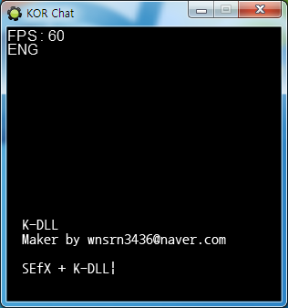

# K-DLL

[English](README.md)

게임메이커에서 한글을 입력받게 하는 C++ DLL 이다. 게임메이커는 조합이 끝난 글자만 `keyboard_string` 에 넣어 주기 때문에 지금 치고 있는 한글이 화면에 보이지 않는다. 이 DLL 은 Windows 의 IME 에서 조합 중인 글자를 직접 읽어 온다. 한/영 상태를 코드에서 바꾸거나 읽고 IME 조합상자를 숨기며 CP949 와 UTF-8 사이의 변환도 한다. DLL 과 게임메이커 확장 패키지, 채팅창 예제로 구성된다.

<p>
  
</p>


## 사용 방법

Releases에서 받은 압축 파일에는 게임메이커 8 확장 패키지 `k-dll.gex` 와 예제 프로젝트가 들어 있다. 확장 패키지를 설치하고 프로젝트에 포함한 뒤 `kdll_init()` 을 한 번 호출한다.

| 함수 | 동작 |
|---|---|
| `kdll_init()` | 게임 창을 찾는다. 다른 함수보다 먼저 한 번 호출한다 |
| `ime_get_string_ansi()` | 조합 중인 글자를 CP949 문자열로 돌려준다. 조합 중이 아니면 빈 문자열 |
| `ime_get_string_utf8()` | 조합 중인 글자를 UTF-8 문자열로 돌려준다 |
| `ime_set_language(mode)` | 입력 언어를 바꾼다. 0 은 영문, 1 은 한글. 조합 중이던 글자는 취소된다 |
| `ime_get_language()` | 지금 한글 입력 상태인지 돌려준다 |
| `ime_set_composition_window(show)` | 0 이면 IME 조합상자를 숨기고 1 이면 다시 보인다 |
| `encoding_ansi_to_utf8(str)` | CP949 문자열을 UTF-8 로 바꾼다 |
| `encoding_utf8_to_ansi(str)` | UTF-8 문자열을 CP949 로 바꾼다 |
| `ansi_ord_at(str, index)` | 문자열의 `index` 번째 바이트 값을 돌려준다. `index` 는 1 부터 |

채팅 입력은 확정된 글자 `keyboard_string` 뒤에 조합 중인 글자를 이어 그리면 된다.

```gml
sex_draw_text(16, 256, keyboard_string+ime_get_string_ansi())
```

예제는 300x300 채팅창이다. 글자를 치면 조합 중인 한글까지 바로 보이고 Enter 로 로그에 쌓이며, Backspace 는 한글 한 글자를 통째로 지운다. 왼쪽 위에 FPS 와 한/영 상태가 표시된다.


## 구현 원리

**게임 창을 직접 찾는다.** 게임메이커는 DLL 에 창 핸들을 주지 않는다. `kdll_init` 은 최상위 창을 차례로 돌면서 현재 프로세스의 것을 찾아 잡아 두고, 이후 모든 함수가 이 핸들로 IME 컨텍스트를 얻는다.

```cpp
hWnd=FindWindow(NULL, NULL);

while(hWnd!=NULL)
{
    if(GetParent(hWnd)==NULL)
    {
        GetWindowThreadProcessId(hWnd, &idProc);
        if(TempCurrProcId==idProc){break;}
    }
    hWnd=GetWindow(hWnd, GW_HWNDNEXT);
}
```

**조합 중인 글자는 IME 에서 읽는다.** `ImmGetCompositionString` 을 길이를 물어보는 호출과 내용을 받는 호출로 두 번 불러 조합 문자열을 얻는다. ANSI 판은 그대로 돌려주고 유니코드 판은 `WideCharToMultiByte` 로 UTF-8 로 바꿔서 넘긴다. 글자가 확정되면 게임메이커가 `keyboard_string` 에 넣어 주므로, 둘을 이어 붙이면 입력 중인 문장이 된다.

**조합상자는 창 밖으로 옮겨 숨긴다.** IME 조합상자를 끄는 API 는 없어서 `ImmSetCompositionWindow` 로 상자 위치를 창 왼쪽 위에서 1000픽셀 밖으로 보낸다. 그런데 IME 가 조합을 시작할 때마다 위치를 되돌리므로, `WH_GETMESSAGE` 훅을 걸어 `WM_IME_COMPOSITION` 메시지가 올 때마다 다시 옮긴다. 다시 보이게 할 때는 훅을 풀고 기본 위치로 되돌린다.

```cpp
case WM_IME_COMPOSITION:
    {
        if(hIMC=ImmGetContext(hWnd))
        {
            tagRECT tagRect;
            GetWindowRect(hWnd, &tagRect);
            COMPOSITIONFORM cf;
            cf.dwStyle=CFS_POINT;
            cf.ptCurrentPos.x=tagRect.left-1000;
            cf.ptCurrentPos.y=tagRect.top-1000;
            ImmSetCompositionWindow(hIMC, &cf);
            ImmReleaseContext(hWnd, hIMC);
        }
        break;
    }
```

**인코딩 변환은 유니코드를 거친다.** `MultiByteToWideChar` 로 유니코드로 올린 뒤 `WideCharToMultiByte` 로 목표 인코딩으로 내린다. 결과는 DLL 안의 버퍼에 담아 돌려주고 다음 호출 때 지운다.


## 파일

| 경로 | 내용 |
|---|---|
| `source/ime.cpp`, `source/export.h` | DLL 소스 |
| `source/KDLL.dev`, `source/Makefile.win` | wxDev-C++ 프로젝트와 MinGW 메이크파일 |
| `docs/screenshots/` | 스크린샷 |
| Releases | 확장 패키지와 예제 |


## 크레딧

예제의 한글 출력 스크립트(Sefx)는 게임메이커 커뮤니티의 김게맛(sodium031)님이 만든 것이다.


## 라이선스

zlib 라이선스다. 자세한 내용은 [LICENSE](LICENSE) 에 있다. 함께 들어 있는 것 중 다른 사람이 만든 라이브러리는 각자의 라이선스를 따른다.
